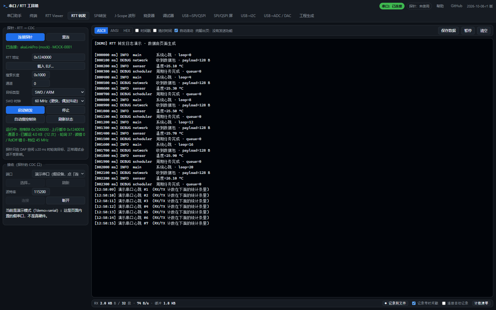
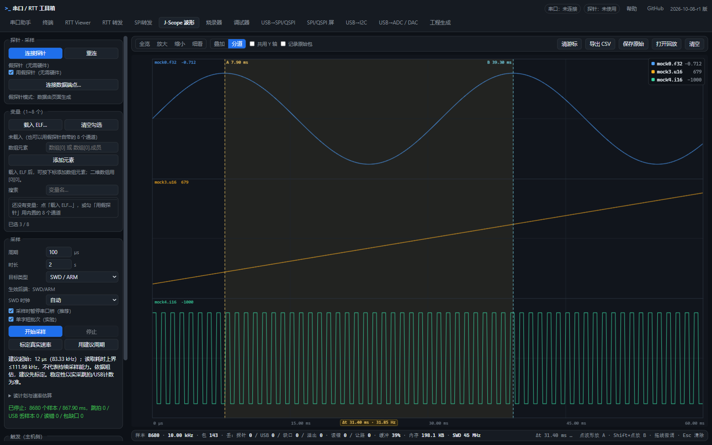
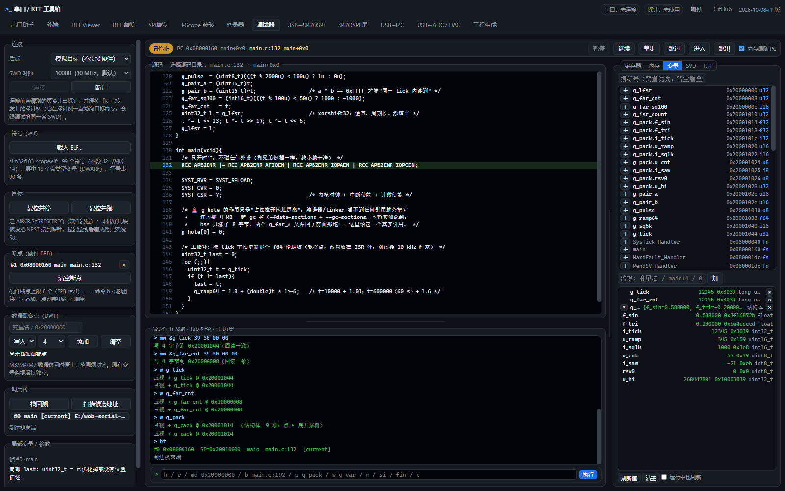
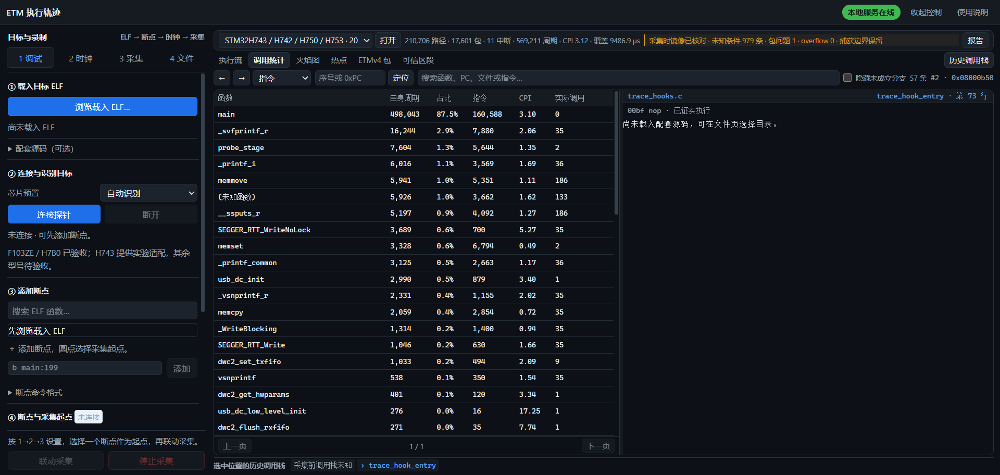
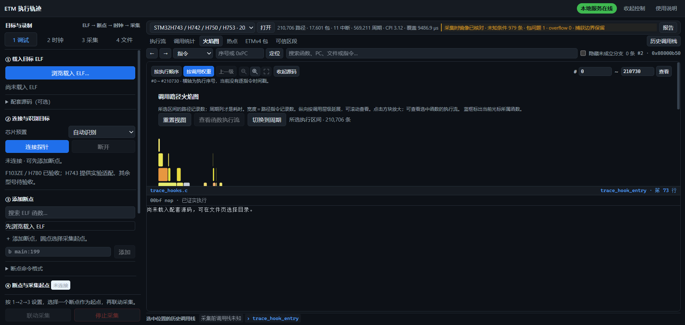

<div align="center">

# superlinkPRO

**一支探针 + 一个网页 = 整条嵌入式调试工作流**

RTT · J-Scope 波形 · 烧录 · 源码级调试 · **ETM 执行轨迹与周期计数** · SPI/I2C 桥


[快速开始](#快速开始) · [功能总览](#功能总览) · [界面预览](#界面预览) · [ETM 执行轨迹](#etm-执行轨迹) · [实测性能](#实测性能) · [文档索引](#文档索引)

</div>

---

## 为什么是 superlinkPRO

传统做法要装驱动、装 IDE、装厂商工具，换一次芯片就得再换一套软件。superlinkPRO 把三件事合成一套：

| | 传统方案 | superlinkPRO |
|---|---|---|
| 上位机 | 安装 IDE / 厂商工具链（数百 MB） | **浏览器打开即用**，无驱动、无插件 |
| 探针 | 商用量产探针，功能受固件限制 | **自研 akaLinkPro 探针**：SWD 60 MHz、JTAG、WebUSB 原生 |
| 数据 | RTT、波形、trace 各一套工具 | **同一个页面**：RTT / J-Scope / 烧录 / 调试 / **ETM trace** |
| 执行轨迹 | 高端 trace 探针 + 昂贵软件 | **ETM 四线引出 + 网页解码**，含**周期计数**（函数耗时/CPI） |

仓库由三部分组成：

* `firmware/`、`script_test/` —— **探针固件与标定脚本**（HPM5301：CMSIS-DAP + CDC + 自定义 HID + WebUSB）
* `web/` —— **网页工作台**（串口、RTT、J-Scope、烧录、调试器、SPI/I2C 桥、屏驱动、工程生成）
* `etm/` —— **ETM 执行轨迹**（Kingst LA 采集 → TPIU 解复用 → OpenCSD 解码 → 源码级回放）

> 仓库是怎么从三个项目合并来的：见 [docs/merge-readme.md](docs/merge-readme.md) 与 [docs/merge-map.md](docs/merge-map.md)。

## 功能总览

| 页面 | 能做什么 | 实测 / 状态 |
|---|---|---|
| **串口 / 终端** | Web Serial + WebUSB 双后端，HEX/文本、发送历史、记录到文件 | 稳定 |
| **RTT Viewer** | SWD 轮询或 RISC-V/JTAG（SBA 直读），自动找控制块、通道/缓冲配置 | STM32 **447 KB/s**、RISC-V **60–77 KB/s** |
| **RTT 转发** | 探针侧桥把 RTT 搬到 CDC，主机直接用串口工具 | **3.05 MB/s**（60 MHz 档） |
| **J-Scope 波形** | 8 变量、多泳道/叠加、A/B 游标、实时 CSV / 原始包流 | 单变量 **495.8 kHz @ 2 µs**（名义 500 kHz；探针跳拍 ≈0.8%、探针本体 629 kHz；稳定窗 USB 丢 0 / 读错 0，边界另计）；8 通道 50 kHz 零丢 |
| **烧录器** | STM32（AHB-AP flashloader）与 HPM RISC-V（XPI + XIP 校验），含校验与自愈 | H743 31.6 KB **2.4 s**；HPM 246 KB **8.2 s** |
| **调试器** | 断点/单步/寄存器/RAM、**源码级单步**（F10/F11/跳出）、结构体树、命令行 | ARM + RISC-V，与 gdb 逐地址对照通过 |
| **SWO 执行轨迹** | 目标 SWO（NRZ）经 VCOM 接收、**PC 采样**、源码级回放与完整导出；UART 240 MHz，**最高 30 Mbaud（30 MHz 时钟）** | 30 Mbaud 连续 6 s：**2,424,768 PC / 12.9 MB**（≈404k PC/s），畸形包 / overflow / 未知 PC / UART 错误 0 |
| **ETM 执行轨迹** | ETMv4 / ETMv3.4 四线并行采集、TPIU 解复用、源码回放、**周期计数** | H743 10 ms → **210,706 指令**；F103ZE 172,596 指令 |
| **SPI / I2C 桥** | 通用帧 DSL、寄存器面板、定时采集、SPI/NOR Flash 测试 | SPI 发图 **6.29 MB/s**（四线 16.77） |
| **SPI→CDC 转发** | 探针把目标 SPI 字节流从原生 CDC 转发到串口工具，网页提供引脚图与高流量门控 | 60 MHz 档 **7.53 MB/s**（Web 默认 4 KiB 缓冲，30 s 零缺帧）；原生 CDC **8.41 MB/s @ 67 MHz**（30 s 长测 0 误码） |
| **USB→ADC 示波器** | 单通道 ADC、时间/电压游标、自动测量、CSV；DAC 波形预留 | 持续 **1 / 2 MSa/s**，8/10/12/16 位各 30 s 计数一致、无溢出（DMA） |
| **SPI/QSPI 屏** | 面板初始化表、图片/图案/动画、**局部刷新** | QSPI 四线 40/60 MHz **13.2 / 16.77 MB/s**（像素传输；完整墙钟约 10.1）；SPI 单线真屏 4.22 MB/s |
| **工程生成** | Keil `.uvprojx` → CMake + J-Link/OpenOCD/pyOCD 配套件 | 与 Python 工具逐字节对拍 |

## 界面预览

<div align="center">

**RTT 转发 / 终端**



**J-Scope 波形（多泳道 + 游标）**



**调试器（源码级单步 + 结构体 + 寄存器高亮）**



</div>

## ETM 执行轨迹

2026-10 新增的主线能力：**把 Cortex-M 的 ETM 端口接出来，用逻辑分析仪采原始波形，在网页里解出"程序到底执行了什么"**。

* **并行采集**：ETMv4（STM32H743，4 位 DDR → TPIU）与 ETMv3.4（STM32F103ZE，PE2–PE6 四位并行）
* **解码链路**：TPIU 帧同步/解复用 → OpenCSD 1.8.3 → 指令级事件 → 源码映射
* **源码回放**：执行流按源码行回放，可导出**简化 C**（按执行顺序排列的源码行 + 函数上下文）
* **周期计数**（ETMv4 独有）：函数**自身周期 / 占比 / CPI / 覆盖时长**、**周期加权火焰图**
* **单次窗口上限 200 ms**（一次采集 + 一次解码；200 ms 记录完整处理的历史单次为 60～62 s、后续完整重跑 103～108 s，均属特定运行、不承诺固定速度，见 [docs/etm-performance-baseline.md](docs/etm-performance-baseline.md)）；旧的长窗分窗记录仍可打开

<div align="center">

**函数耗时视图（自身周期 · 占比 · 指令数 · CPI）**



**周期加权火焰图（宽度＝周期，不是记录数）**



</div>

实测（H743，CPU 60 / TRACECLK 30 MHz，10 ms 窗口）：

| 指标 | 数值 |
|---|---|
| 指令 / 包 | **210,706** 条 / 17,601 包，包问题 0 |
| 周期元素 / 总周期 | 2,126 个 / **569,211** 周期 · CPI **3.12** · 覆盖 **9,486.9 µs** |
| 函数耗时 Top | `main` 87.5%（CPI 3.10）· `_svfprintf_r` 2.9% · `dwc2_low_level_init` CPI **17.25** |
| TPIU 使用率 | 全关 **5.62%** / 返回栈 **5.10%** / 周期计数 **7.45%**（带宽远未饱和，瓶颈是采样余量） |

型号支持：

| 型号 | ETM 版本 | 选项能力 | 状态 |
|---|---|---|---|
| STM32F103ZE | ETMv3.4 | 分支广播 | 已适配 |
| STM32H743 | ETMv4 | 分支广播 / 返回栈 / **周期计数** | 已适配 |
| STM32H7B0 | ETMv4 | 三项 | 已适配 |

> 验收数字与限制见 [docs/acceptance-2026-10-18-etm.md](docs/acceptance-2026-10-18-etm.md)；
> 周期计数用途见 [docs/cycle-count.md](docs/cycle-count.md)；带宽分析见 [docs/tpiu-utilization.md](docs/tpiu-utilization.md)。

## 实测性能

以下数字来自 **akaLinkPro 探针 + 真实浏览器页面 + 对应目标板** 的实测，不是理论值。
不同 USB 口、供电与浏览器负载会影响结果。

| 项目 | 实测结果 | 条件 |
|---|---|---|
| RTT 转发 | **3.046 MB/s**（45 MHz 档 2.577） | F103ZE 96 MHz 靶子；页面 RX = 探针侧自报 |
| RTT Viewer（SWD） | **447 / 477 KB/s** | H743 @60 MHz，轮询约 110 Hz |
| RTT Viewer（RISC-V） | **60–77 KB/s** | HPM6800EVK，SBA 批量读 |
| J-Scope | 单变量 **495.8 kHz @ 2 µs**（名义 500 kHz；探针跳拍 ≈0.8%、探针本体 629 kHz；稳定窗 USB 丢 0 / 读错 0，启动/停止边界另计）；50 kHz 档跳拍 ≈20 ppm、8 通道 50 kHz 零丢 | F103ZE 96 MHz 靶子，60 MHz 档 |
| SWO PC 采样 | 最高 **30 Mbaud（30 MHz 时钟，UART 240 MHz）**；30 Mbaud 连续 6 s：**2,424,768 PC / 12.9 MB**（≈404k PC/s），畸形包/overflow/未知 PC/UART 错误 0 | F103CB HSE/PLL 60 MHz、PC /128、纯 PC；另有 18 Mbaud 下 252,198 PC/s 与 236 个 PC 的 GNU 定位全一致记录 |
| ADC 示波器 | **1 / 2 MSa/s** 持续采集，8/10/12/16 位各 30 s 计数一致、无溢出 | EVKLite，硬件触发 + DMA，含网页卡顿注入 |
| SRAM 读写（网页） | 读 **2.743** / 写 **3.042 MB/s** | 60 MHz 档，1024 B 包、在飞 4 |
| SPI 发图 | 单线 **6.29 MB/s**、四线 **16.77 MB/s** | SCK 60 MHz，32 KiB 批次 |
| SPI→CDC 转发 | 60 MHz **7.53 MB/s**（Web 默认 4 KiB 缓冲，30 s 零缺帧）；原生 CDC **8.41 MB/s @ 67 MHz**（30 s 长测 0 误码） | H743 发送板；Web 默认建议 60–64 MHz，见 `docs/validation/2026-10-08-h743-spi-cdc.md` |
| QSPI 刷屏（四线） | 40/60 MHz **13.164 / 16.766 MB/s**（像素传输）；完整墙钟 **10.13 MB/s** @60 MHz/32 KiB | ST77916 360×360×2 B；本轮未接屏，只验传输与计数 |
| SPI 点屏（单线） | 40 MHz 真屏 **4.22 MB/s**（线速 88%）；60/75 MHz 饱和约 **4.7 MB/s** | AXS15352 240×296×2 B，真实屏幕；见 docs/validation/2026-10-08-spi-fixed240.md |
| 烧录 | H743 31.6 KB **2.4 s**；F103ZE 0.7–1.0 s；HPM 246 KB **8.2 s** | 含擦除 + 写入 + 回读校验 |
| ETM | 10 ms → **210,706 指令**、**569,211 周期** | H743 ETMv4，500 MSa/s LA |
| ETM 记录加载（KVDAT） | 200 ms 记录首屏：历史单次 **60.5–62.2 s**，后续完整重跑 **103–108 s**（源码/EXE 均实测），**尚无稳定 60 s 保证**；首次整段执行顺序窗口 **0.97–1.02 s**（原 43.9–46.9 s） | 特定运行、源码口径，不含 LA 上传/保存/浏览器绘制；计时段与复现命令见 [docs/etm-performance-baseline.md](docs/etm-performance-baseline.md) |
| ETM 原始记录体积（200 ms） | 旧链路 **CSV 500.4 MB + KVDAT 92.3 MB → KVDAT 92.3 MB**（约 **6.4×**；只算 CSV 为 **5.4×**） | 同一 H743 200 ms 记录；KVDAT 按边沿存储，极端高频翻转信号不保证同比例 |

## 快速开始

### 1. 直接用网页（零安装）

打开 <https://minichao9901.github.io/superlinkPRO/>，插上探针，浏览器会请求 USB/HID/串口授权。

> Chrome / Edge 支持 WebUSB 与 WebHID；Web Serial 需要 Chromium 内核浏览器。

### 2. 本地桥（离线可用）

`web/bridge/etm/downloads/etm-bridge-win64.zip`（**1.0.14-native.11，约 78.7 MB**）完整解压后双击
`start-etm-bridge.bat`。包内自带 Python、依赖、网页和原生解码器，无需安装 Python 或 Node，
默认启用原生优化链路。升级前退出旧工作台并保留 `data` 目录。

```text
start-etm-bridge.bat    # 起本地桥并打开网页
check-tools.bat         # 检查完整包与运行资源
```

### 3. 烧探针固件（可选）

```bash
cd firmware/application_5301 && build_dfu_evklite.bat      # 构建
py script_test/hpm6800_flash_probe.py --no-build            # 经 HID 进 DFU 后写入
```

> 烧录前先关掉占用探针的浏览器页签，否则 HID 会被独占。

## 硬件与兼容性

| 角色 | 支持情况 |
|---|---|
| 探针 | **akaLinkPro**（HPM5301：CMSIS-DAP v2 + CDC + 自定义 HID + WebUSB + DFU），SWD 最高 60 MHz，JTAG 支持 RISC-V |
| ARM 目标 | STM32F103（含 ZE 大容量）、STM32F4、STM32H7B0、**STM32H743**（ETMv4） |
| RISC-V 目标 | HPM6800EVK、HPM5301EVKLite 等 HPM 系列（JTAG + SBA + 触发器断点） |
| 逻辑分析仪（ETM 用） | KingstVIS 系列（USB socket API），500 MSa/s · 5M 点/通道 |

已知边界（建议先读）：

* **ETM 分支广播 / 三项全开**在 500 MSa/s 下会因 2.08 样本/位位滑而 demux 失败 —— 带宽不是瓶颈，采样余量才是（见 [docs/tpiu-utilization.md](docs/tpiu-utilization.md)）
* Web Serial 的端口选择框**必须人工授权一次**（浏览器安全模型），其余授权可由脚本预置
* 网页调试器覆盖断点/单步/寄存器/结构体，**不含**反汇编编辑器、RTOS 视图与多核同步

## 目录结构

```text
superlinkPRO/
├── firmware/        探针固件（HPM5301，DFU 打包与构建脚本）
├── script_test/     探针标定与真机回归脚本（RTT / SWD / scope 基线）
├── web/             网页工作台（app/ 源码、tools/ 自测、docs/ 文档与截图）
│   └── bridge/etm/  ETM 本地桥与便携包
├── etm/             ETM 执行轨迹（tools/ 解码与后端、web/ 前端、records/ 记录）
├── docs/            合并说明、验收记录、设计与决策文档
└── .github/         Pages 自动发布
```

## 文档索引

| 主题 | 文档 |
|---|---|
| 仓库合并说明（原 README） | [docs/merge-readme.md](docs/merge-readme.md) · [docs/merge-map.md](docs/merge-map.md) |
| ETM 验收与限制 | [docs/acceptance-2026-10-18-etm.md](docs/acceptance-2026-10-18-etm.md) |
| 周期计数的用途 | [docs/cycle-count.md](docs/cycle-count.md) |
| TPIU 使用率 / 带宽分析 | [docs/tpiu-utilization.md](docs/tpiu-utilization.md) |
| 探针 60 MHz 稳定性 | [docs/probe-60mhz-instability-analysis.md](docs/probe-60mhz-instability-analysis.md) |
| 合并验收记录 | [docs/merge-verification.md](docs/merge-verification.md) · [docs/hpm6800-acceptance-2026-10-18.md](docs/hpm6800-acceptance-2026-10-18.md) |
| 网页工作台细文档 | [web/README.md](web/README.md) · [web/docs/](web/docs/) |
| ETM 细文档 | [etm/README.md](etm/README.md) · [etm/docs/](etm/docs/) |

## 许可证

Apache License 2.0 —— 见 [LICENSE](LICENSE)。
