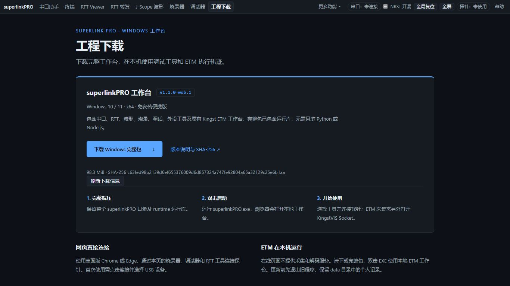

# WebUSB 工作台重构与 Windows 本机包验收

> 后续F103ZE真机、修复及web.2交付见[2026-11-07报告](../webusb-hardware-20261107/README.md)。下文保留web.1离线交付的原时点证据。

2026-11-06（Asia/Shanghai）。实施基线 superlinkPRO `fb46f9e59e3de671620e92dbe1669da3d6471560`，参考 zynqlinkPRO `b5d3f3de`。本次改动未提交、未推送，包清单明确 `sourceDirty=true`，以实际源码输入和包文件 SHA-256 绑定，不把基线提交当成完整改动版本。

## 交付与范围

- 仅保留 WebUSB / CMSIS-DAP 调试后端；移除 OpenOCD/J-Link 桥实现、配置入口、工程生成及其独有自测/嵌入工具。历史报告和回归输入保留。
- 增加工程下载页，显示当前包版本、大小、SHA-256 和使用步骤。`toolbox.py bridge-build` 构建本机 `dist/superlinkPRO/superlinkPRO.exe`，完整 ZIP/清单在根 `dist/`；更新时归档旧程序并保留 data。未替换旧正式下载或发布线上站点。
- 迁入设置收起及摘要、串口/RTT/转发最近128KiB日志检索、四页目标/ELF显式复用、波形下一步引导与收尾计数、目标时钟策略、固件字节/ELF结构查看器，以及ARM单步握手修正。
- 保留SPI/QSPI、屏、SPI转发、SWO、I2C、ADC/DAC等工具及示例。Zynq专属服务/FPGA能力没有被声明为现有软件探针能力；旧RISC-V流协议仍保留零idle覆盖约定。
- ETM页面、线上副本、主页面ETM包装模块及ETM后端/原生源码共1295个既有文件与改动前逐文件SHA一致；共享驱动8份及线上副本31份检查通过。原native.15运行时按现有provenance核验后复用，未重新构建C++、没有迁移Zynq采集、飞行记录或新ETM分析功能。

## 最终产物身份

| 项目 | 值 |
|---|---|
| 版本 | `1.1.0-web.1` |
| EXE | `dist/superlinkPRO/superlinkPRO.exe` |
| EXE SHA-256 | `e4fef12cf647940aefe6fd10ead3dca9bab5f29adf56b762436f21ffc11e272b` |
| 分发ZIP | `dist/superlinkPRO-win64.zip`，102549358 B |
| ZIP SHA-256 | `73a0392c18844cf8ea855aa3167dd2191cb8018240524c1c349d9193794cbb4d` |
| 包身份 | `256af48c6c5299f32b167bcb96730a53b4559702db5e848a3e48c6b0adba209e` |
| 包文件数 | 3582，逐项尺寸/哈希一致 |
| ETM运行时来源 | `ca0c7fbbff238aa4a254f5102d9660e961eed394`，既有native.15快照 |

清单中的 `sourceInputs` 保存本轮实际Web/启动器输入指纹，`source-provenance.json`保存ETM快照来源。包及下载内容不含用户data或已退役的工程生成/调试桥实现。EXE启动后可重新打包自身运行资源；其HTTP下载ZIP采用另一压缩过程，SHA与根dist分发ZIP不同，两者分别按各自清单核对，不能混用。

## 验证

| 检查 | 结果与范围 |
|---|---|
| Web离线逻辑 | 247/247通过；使用独立离线入口，浏览器/硬件脚本与可选C模型明确另列 |
| 统一CLI | 9/9通过；64个命令/分类节点、15页/741个静态控件参考生成与检查一致 |
| 启动器引擎/示例 | 5项引擎、4项seed测试通过 |
| 实际浏览器CLI | 15页describe通过；固件文件input、DAC离线预览/CSV导出通过，1131B/41行与原字节指纹一致 |
| 新功能页面 | 真F103 ELF查看、RTT/调试/波形显式复用、HPM最高25MHz选项、三页日志检索入口通过；无页面错误，无实体探针连接 |
| 冻结EXE | PATH去掉Python/Node后的预检、HTTP示例重新解码、CLI查询和选定区间SVG导出通过 |
| 冻结原生重解码 | 示例47537条指令、2876包、包问题0、unknownExecution39；保留未知证据，不作为新真机采集 |
| HTTP下载 | 完整读取103086646B，SHA `c63fed98b2139d6ef655376009d6d857324a747fe92804a65a32129c25e6b1aa`，与该HTTP清单一致 |
| 页面布局 | 冻结页面1366×768，scrollWidth1366，顶栏高度36.4px；无横向溢出，版本和下载入口可见 |
| 本机浏览器启动 | 交付EXE设置标准Medium文件标签；普通自动打开路径返回0，观察到Chrome工作台窗口 |

复现入口（均不进行板卡采集/烧录）：

```powershell
python -X utf8 tools/test_workbench_offline.py --output tmp/web-offline-NEW
python -X utf8 -m unittest tools.tests.test_toolbox_cli -v
python -X utf8 toolbox.py bridge-build
python -X utf8 tools/verify_workbench_package.py --output tmp/package-verify-NEW
node web/tools/dev/build-web.mjs --check
node web/tools/dev/sync-shared-drivers.mjs --check
node web/tools/dev/sync-etm-page.mjs --check
python -X utf8 tools/build_cli_options.py --check
node tools/build_toolbox_reference.mjs --check
```

实际页面验证仍需打开运行时给出的工作台URL并保留浏览器worker。工程生成分类已替换为download，旧生成器用例退役；原始测试夹具未清理。

## 失败保留与未完成项

- 首轮直接全匹配旧`.test.mjs`混入CDP/硬件驱动及旧工作目录假设，产生环境/路径失败；已改用明确的离线选择器，浏览器通过实际工作台CLI另验。日志保留在本机任务目录。
- 修正调试模拟器的旧C_HALT/C_STEP语义；更新RTT/波形生命周期用例的等待边界及10MHz烧录数据默认契约后，原核心回归通过，没有以删除这些回归掩盖失败。
- ISSUE-029：首个冻结包重新解码时原生prescan无法写系统TEMP、退出7；失败job `def22fd4d8e34939b3d0ad2111928bf0`保留。最终启动器仅为自身及子进程配置data/runtime-tmp，重新冻结后的HTTP原生重解码通过。系统目录权限根因未更改；独立CLI验证显式给本次子进程设置了工程内TEMP，验证范围为query/export。
- ISSUE-038：本机GCC16.1最小C编译返回1且无输出，工程内TEMP重测仍失败。analog-wire/bus-periodic两个C模型未通过，不据Web逻辑通过宣称C模型通过；生产固件没有修改。
- ISSUE-039：构建目录给EXE继承Low MIC，交付器仅规范候选/安装EXE的桌面标签，不改变系统/父目录策略；用户解压到其他Low目录的行为未推广验收。
- ISSUE-036：单步软件修复/模型/专项通过，本仓真机单步、断点与中断恢复专项仍待验收。未复位、烧录、采集或测硬件吞吐，没有访问Kingst硬件。

精简机器证据见 [summary.json](summary.json)，页面见下图。本机完整过程记录在 `tmp/web-refactor-20261106/`，运行时令牌未纳入报告。历史`.formal-trace-20261024/`等资产未动。


