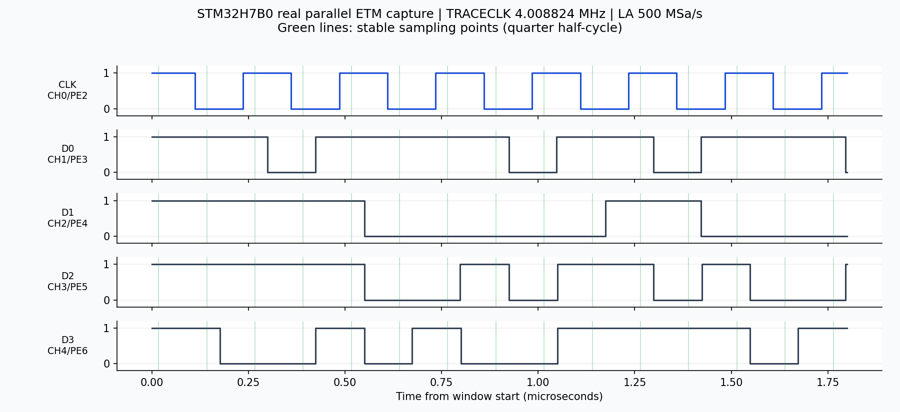

# STM32H7B0 并行 ETM 首次采集记录

补充：后续已完成完整 ETMv4/机器码/源码解码。SWD 核对发现板上是第一轮构建版本，已重建逐字节匹配的 ELF 并使用实际 ETM 寄存器重新验收；本页保留首次物理采集记录，当前解码结果以 [网页初版说明](../网页初版.md) 为准。

2026-10-11，用户通过现有 Web 工具烧录测试固件，接好 CH0~CH4 = PE2~PE6，随后本会话通过 KingstVIS Socket API 进行两次真实采集。

**结论：并行 trace 输出、LA 采集及 TPIU 解帧已跑通。** 已检查的数据源为预期的 trace ID 2，并包含 ETMv4 A-Sync 候选。尚未进行完整 ETMv4 包解码、机器码路径重建或源码执行流验收。

## 实测结果

| 项目 | 500 MSa/s | 100 MSa/s |
|---|---:|---:|
| 采集时长 | 10 ms | 10 ms |
| 实际采样深度 | 5,000,000 | 1,000,000 |
| TRACECLK 均值 | 4.008824 MHz | 4.008214 MHz |
| 时钟跳变数 | 80,176 | 80,164 |
| 异常半周期数（偏离中位数 >25%） | 0 | 0 |
| D0/D1/D2/D3 跳变数 | 2568 / 2628 / 1250 / 35776 | 2536 / 2620 / 1218 / 35452 |
| 恢复的完整 TPIU 帧 | 121 | 121 |
| TPIU 帧结构错误 | 0 | 0 |
| FSYNC / HSYNC 数 | 2434 / 13685 | 2589 / 13666 |
| 识别到的数据源 ID | 2 | 2 |
| ID 2 有效输出字节数 | 1740 | 1700 |
| ETMv4 A-Sync 候选数 | 2 | 1 |
| 取样点至最近数据跳变最小距离 | 30.5 ns | 27.5 ns |

HSI 是内部振荡器，约 +0.22% 的频率偏差不影响本次验证。100/500 MSa/s 为两次不同时间窗的采集，trace 数据字节数无需相同。

## 采样位置修正

500 MSa/s 波形中，数据跳变到最近 TRACECLK 边沿的距离为 **58~62 ns，中位 60 ns**，接近 125 ns 半周期的中点。
原先固定在半周期中点取样，容易落入数据跳变区。分析工具默认改为半周期 1/4 处，且允许调整。

同一份 500 MSa/s 波形分别在半周期 1/4 与 3/4 处取样；选择对应字节相位并偏移一个字节后，**重叠的 40,086 字节全部一致，差异为 0**。
这比单纯数同步序列更能支持物理采样结果。直接在中点取样会得到不同的错误候选计数，不能以同步命中较多来选择采样位置。



图为 500 MSa/s 原始采集在约 66.81 μs 起的一段 1.8 μs 窗口，非合成波形。

另一个修正是兼容中文 KingstVIS 导出的 GBK 编码“通道 N”CSV 表头。以上修改仅涉及分析工具，没有修改用户已经烧录的固件。

## 保存的证据

| 文件 | 内容 |
|---|---|
| `captures/trace-20261011-000319.csv` / `.kvdat` | 500 MSa/s 原始采集 |
| `captures/trace-20261011-000319.trace.json` | 默认稳定区物理分析 |
| `captures/trace-20261011-000319.phase0.bin` | 本次有效 TPIU 字节相位 |
| `captures/trace-20261011-000319.phase0.id2.bin` | 解复用后的 ETM 字节流 |
| `captures/trace-20261011-000319.phase0.tpiu.json` | TPIU 帧与数据源统计 |
| `captures/trace-20261011-000319-quarter.*` / `-threequarter.*` | 同一波形的两侧采样对照 |
| `captures/trace-20261011-000616.csv` / `.kvdat` | 100 MSa/s 原始采集 |
| `captures/trace-20261011-000616.trace.json` / `.phase0.tpiu.json` | 第二次物理/TPIU 分析 |

本次本地 ELF 的 SHA-256 为 `aaf9f8d165c661666b806b8da9337051c1a6ce6545b5f5bdf3920d23534b7138`；用户确认已烧录该测试固件，本次未读取目标 Flash 做逐字节核对。

分析入口：

```powershell
python -X utf8 .\tools\trace_port.py .\captures\trace-20261011-000319.csv
python -X utf8 .\tools\tpiu_demux.py .\captures\trace-20261011-000319.phase0.bin
python -X utf8 -m unittest discover -s .\tools\tests -v
```

TPIU 同步、辅助位及源 ID 切换处理按 [OpenCSD 官方实现](https://github.com/Linaro/OpenCSD/blob/master/decoder/source/trc_frame_deformatter.cpp) 核对；本工具为本项目的独立 Python 实现。

## 结果边界

采集开始时已在持续运行，500 MSa/s 数据开头跳过 1033 字节以找到 FSYNC，并有 60 字节尚未确定源 ID；结尾 12 字节不完整帧不输出。100 MSa/s 对应为 445 / 100 / 12 字节。
这属于窗口边界处理，不能将整个采集窗口称为完整执行历史。零帧结构错误也不能证明 ETM 内部没有 overflow；下一步应以实际 ETMv4 包解码检查 overflow/discontinuity，并结合配套 ELF 恢复执行路径。
